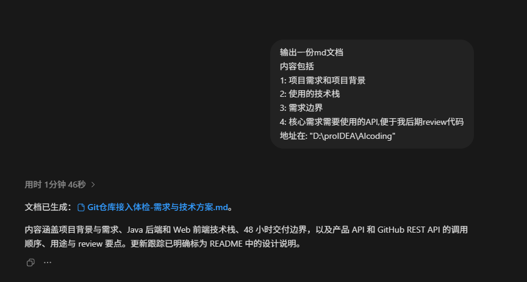
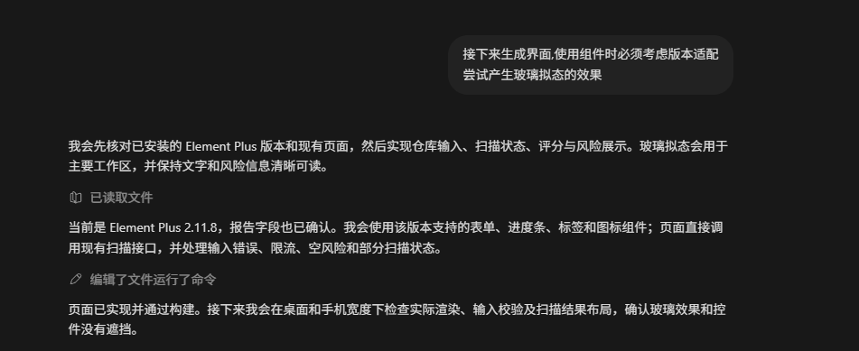

# AI 使用与人工验证记录

## 使用方式

项目开发过程中使用 Codex 辅助需求整理、技术方案拆解、Java 后端与 Vue 前端代码生成、单元测试编写、联调排错和文档整理。AI 生成的是候选实现；功能边界、依赖版本、风险处理、测试结论和是否采用改动由开发者根据题目与实际运行结果决定。

具体做法是先把题目拆成可检查的行为：固定 commit、文件清单与有限文本扫描、确定性评分、敏感内容不回显、页面展示覆盖范围。每完成一段就运行编译或测试，并通过 API 与浏览器实际使用；发现结果与预期不符时回到规则和数据流排查。

## 提示词与过程截图

### 需求拆解

提示词要求 AI 输出包含项目背景、技术栈、需求边界与核心 API 的 Markdown 文档，供开发前逐项审阅。开发者再依据面试题原文补齐背景和验收范围，没有直接把生成内容当成最终需求。

### 前端界面

提示词明确要求“使用组件时必须考虑版本适配”，并尝试玻璃拟态效果。开发者核对项目安装的 Element Plus 2.11.8，再通过构建、桌面和手机截图检查布局与可读性；视觉效果服从风险信息的清晰展示。

这两张截图记录的是输入与过程，不代替运行结果或测试证据；实际验证方法列在下节。

## 验证 AI 输出

| 内容 | 人工验证方法 |
| --- | --- |
| 后端实现 | 阅读 URL 白名单、GitHub API 请求、固定 commit、扫描预算和异常分支；运行 `mvn verify`，查看 JaCoCo 报告 |
| 敏感信息规则 | 使用假测试凭据检查命中，确认报告只包含风险类型、文件和行号，不包含凭据原值 |
| 前端界面 | 运行 `npm run build`；在桌面与手机宽度检查输入、加载、报告和部分扫描状态 |
| 前后端联调 | 真实扫描 `octocat/Hello-World` 与 `nextlevelbuilder/ui-ux-pro-max-skill`，核对 commit、文件数量、风险列表和覆盖提示 |
| 运行环境 | 分别检查匿名与令牌认证的 GitHub 响应，确认 IDE 启动进程确实读取环境变量；日志只显示认证模式，不显示令牌 |

## AI 答错但被发现

**案例 1：README 存在，却没有被扫描。**AI 初版代码用文件名判断无扩展名 `README` 存在，给了文档分，但内容读取候选规则没有包含这个文件名。真实联调 `octocat/Hello-World` 时，页面出现“README 得分 25”与“已读取文件 0 / 1、部分扫描”并存的矛盾结果。开发者据此检查 `ScanRules.score` 与 `ScanService.eligible` 的规则差异，将无扩展名 `README` 加入读取候选。运行 `mvn verify` 并重新扫描后，覆盖数变为 `1 / 1`。这个错误不是靠 AI 自述发现，而是通过跨字段一致性和真实仓库验证发现。

**案例 2：Windows 脚本重复扣分。**AI 初版在文件树阶段和内容扫描阶段都生成了 Windows 脚本风险。`ScanServiceTest` 以同一脚本只计一次的预期检查评分，实际得到 90 分而不是 95 分。开发者定位重复风险来源后，将文件名风险限定在文件树阶段生成，修正后测试通过。

这些记录说明评分和风险项需要用可复现的断言验证，不能仅凭页面有数字就认定正确。

## 技术取舍与边界

- 评分保持确定性规则。曾考虑用 Spring AI Alibaba 生成 AI 评分或建议，但调查后发现目标依赖与当前 Java 8 / Spring Boot 2.3 技术栈暂不兼容，因此没有为了加分项破坏核心功能的可运行性，也没有宣称项目已接入模型。
- 大仓库受文件数、单文件大小与总字节预算限制。报告显式展示 `partialScan` 和覆盖数量，未扫描内容不推断为安全。
- GitHub Token 仅通过环境变量注入。开发过程中曾发现令牌被放进配置默认值，随后清理了配置与待推送历史；真实令牌不用于测试样本，也不记录在本文档中。
